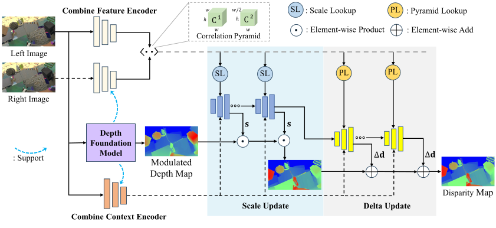
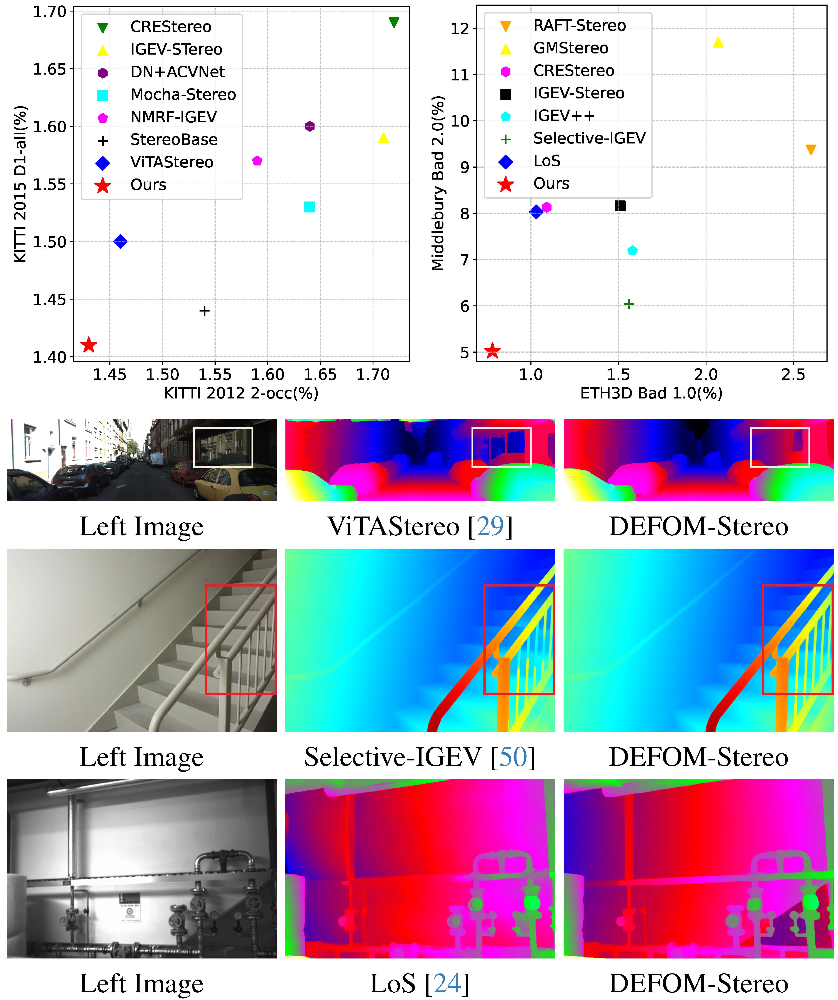
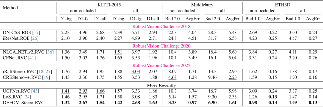

# DEFOM-Stereo [CVPR 2025]

The Official Pytorch Implementation for

> [**DEFOM-Stereo: Depth Foundation Model Based Stereo Matching**](https://arxiv.org/abs/2501.09466)
>
> Authors: Hualie Jiang, Zhiqiang Lou, Laiyan Ding, Rui Xu, Minglang Tan, Wenjie Jiang and Rui Huang

# Abstract
Stereo matching is a key technique for metric depth estimation in computer vision and robotics. 
Real-world challenges like occlusion and non-texture hinder accurate disparity estimation from binocular matching cues. Recently, monocular relative depth estimation has shown remarkable generalization using vision foundation models. Thus, to facilitate robust stereo matching with monocular depth cues, we incorporate a robust monocular relative depth model into the recurrent stereo-matching framework, building a new framework for depth foundation model-based stereo-matching, DEFOM-Stereo. 
In the feature extraction stage, we construct the combined context and matching feature encoder by integrating features from conventional CNNs and DEFOM. In the update stage, we use the depth predicted by DEFOM to initialize the recurrent disparity and introduce a scale update module to refine the disparity at the correct scale. DEFOM-Stereo is verified to have much stronger zero-shot generalization compared with SOTA methods. Moreover, DEFOM-Stereo achieves top performance on the KITTI 2012, KITTI 2015, Middlebury, and ETH3D benchmarks, ranking $1^{st}$ on many metrics. In the joint evaluation under the robust vision challenge, our model simultaneously outperforms previous models on the individual benchmarks, further demonstrating its outstanding capabilities.


# Pipeline
<p align="center">

</p>

- We propose **a novel recurrent stereo-matching framework incorporating monocular depth cues** from a depth foundation model to improve robustness. 
- We develop a simple technique that utilizes **pre-trained DEFOM features** to construct stronger **combined feature and context encoders**.
- We invent a **recurrent scale update** module empowered with the **scale lookup**, serving to recover accurate pixel-wise scales for the coarse DEFOM depth.


# Zero-Shot Perfomance

<p align="center">

</p>

# Benchmark Performance

<p align="center">

</p>

# Robust Vision Challange

<p align="center">

</p>

# Preparation

### Installation

Create the environment

```bash
conda env create -f environment.yaml
conda activate defomstereo
pip install -r requirements.txt
```


### Datasets 
The project requires the follow datasets:

<table style="border-collapse: collapse; width: 80%;">
  <tr>
    <td style="border: 1px solid #000; padding: 8px;"><a class="custom-link" href="https://www.cvlibs.net/datasets/kitti/eval_stereo_flow.php?benchmark=stereo" target="_blank">KITTI-2012</a></td>
    <td style="border: 1px solid #000; padding: 8px;"><a class="custom-link" href="https://www.cvlibs.net/datasets/kitti/eval_scene_flow.php?benchmark=stereo" target="_blank">KITTI-2015</a></td>
    <td style="border: 1px solid #000; padding: 8px;"><a class="custom-link" href="https://vision.middlebury.edu/stereo/submit3/" target="_blank">Middlebury</a></td>
    <td style="border: 1px solid #000; padding: 8px;"><a class="custom-link" href="https://www.eth3d.net/datasets" target="_blank">ETH3D</a></td>
    <td style="border: 1px solid #000; padding: 8px;"><a class="custom-link" href="https://github.com/YuhuaXu/StereoDataset" target="_blank">InStereo2K</a></td>
  </tr>
  <tr>
    <td style="border: 1px solid #000; padding: 8px;"><a class="custom-link" href="https://europe.naverlabs.com/proxy-virtual-worlds-vkitti-2/" target="_blank">Virtual KITTI 2</a></td>
    <td style="border: 1px solid #000; padding: 8px;"><a class="custom-link" href="https://lmb.informatik.uni-freiburg.de/resources/datasets/SceneFlowDatasets.en.html" target="_blank">SceneFlow</a></td>
    <td style="border: 1px solid #000; padding: 8px;"><a class="custom-link" href="https://github.com/castacks/tartanair_tools" target="_blank">TartanAir</a>
</td>
    <td style="border: 1px solid #000; padding: 8px;"><a class="custom-link" href="https://github.com/megvii-research/CREStereo" target="_blank">CREStereo Dataset</a>
</td>
    <td style="border: 1px solid #000; padding: 8px;"><a class="custom-link" href="https://research.nvidia.com/publication/2018-06_falling-things-synthetic-dataset-3d-object-detection-and-pose-estimation" target="_blank">FallingThings</a>
</td>
  </tr>
  <tr>
    <td style="border: 1px solid #000; padding: 8px;"><a class="custom-link" href="http://sintel.is.tue.mpg.de/stereo" target="_blank">Sintel Stereo</a></td>
    <td style="border: 1px solid #000; padding: 8px;"><a class="custom-link" href="https://drive.google.com/file/d/1SgEIrH_IQTKJOToUwR1rx4-237sThUqX/view" target="_blank">HR-VS</a></td>
    <td style="border: 1px solid #000; padding: 8px;"><a class="custom-link" href="https://github.com/sniklaus/3d-ken-burns" target="_blank">3D Ken Burns</a></td>
    <td style="border: 1px solid #000; padding: 8px;"><a class="custom-link" href="https://github.com/HKBU-HPML/IRS" target="_blank">IRS Dataset</a></td>
    <td style="border: 1px solid #000; padding: 8px;"><a class="custom-link" href="https://cvlab-unibo.github.io/booster-web/" target="_blank">Booster Dataset</a></td>
  </tr>
</table>
The datasets are organized as follows,

```
.
└── datasets
    ├── 3dkenburns
    │   ├── asdf-flying
    │   ├── asdf-flying-depth
    │   └── ...
    ├── Booster_Dataset
    │   ├── test
    │   └── train
    ├── CreStereo
    │   ├── hole
    │   ├── reflective
    │   ├── shapenet
    │   └── tree
    ├── ETH3D
    │   ├── two_view_testing
    │   ├── two_view_training
    │   └── two_view_training_gt
    ├── FallingThings
    │   └── fat
    ├── HRVS
    │   └── carla-highres
    ├── InStereo2K
    │   ├── part1
    │   ├── part2
    │   ├── part3
    │   ├── part4
    │   ├── part5
    │   └── test
    ├── IRSDataset 
    │   ├── Home
    │   ├── Office
    │   ├── Restaurant
    │   └── Store
    ├── KITTI12
    │   ├── testing
    │   └── training
    ├── KITTI15
    │   ├── testing
    │   └── training
    ├── Middlebury
    │   ├── 2005
    │   ├── 2006
    │   ├── 2014
    │   ├── 2021
    │   └── MiddEval3
    ├── SceneFlow
    │   ├── Driving
    │   ├── FlyingThings3D
    │   └── Monkaa
    ├── SintelStereo 
    │   └── training
    ├── TartanAir
    │   ├── abandonedfactory
    │   ├── abandonedfactory_night
    │   └── ...
    └── VKITTI2 
        ├── Scene01
        ├── Scene02
        ├── Scene06
        ├── Scene18
        └── Scene20
```


# Evaluation

### Download the pre-trained models
```
bash scripts/download_models.sh
```

The pretrained models are available on [Google Drive](https://drive.google.com/drive/folders/1cZLcIjHlmUo986gkR6FbofG1cj5BT36x?usp=sharing) and can be downloaded mamanually. 

### Perfom Evaluation
```
bash scripts/evaluate.sh
```

### Mixed validation

Run all seven sources with `--datasets mixed`. Set `--mixed_root NAME=PATH` for
each dataset whose files are not at the loader's default path. UnrealStereo4K
always needs a root and defaults to scene `00008` (the out-of-domain test scene).
Its expected layout is `ROOT/00008/{Image0,Image1,Disp0}/`, with matching image
names and `Disp0/*.npy` disparity files. Both original PNG images and the
quarter-resolution JPG images are accepted.

```bash
python evaluate_stereo.py --restore_ckpt checkpoints/model.pth \
  --model_arch cor_ga --datasets mixed \
  --mixed_root sceneflow=/data/SceneFlow \
  --mixed_root middlebury_H=/data/Middlebury \
  --mixed_root unrealstereo4k=/data/UnrealStereo4K \
  --mixed_root sintel_stereo=/data/SintelStereo \
  --mixed_root crestereo=/data/CreStereo \
  --mixed_root tartan_air=/data/TartanAir \
  --mixed_root vkitti2=/data/VKITTI2
```

If VKITTI2 RGB and depth files live under different roots, also pass
`--mixed_root vkitti2_depth=/path/to/depth`.

The names are `sceneflow`, `middlebury_H`, `unrealstereo4k`, `sintel_stereo`,
`crestereo`, `tartan_air`, and `vkitti2`. SceneFlow uses FlyingThings3D TEST;
Middlebury H uses the existing official training-scene list; UnrealStereo4K
uses scene `00008`. By default, validation deterministically selects 100 images
spread uniformly over each ordered dataset; a dataset with fewer than 100 images
uses all of them. For Sintel, CREStereo, TartanAir, and VKITTI2, pass a
`--mixed_manifest NAME=FILE` to evaluate a fixed held-out subset. Each manifest
contains one absolute left-image path per line. Without a manifest, all files
found by that loader are candidates for the uniform selection.
`--mixed_max_samples N` changes the per-source cap.

The output includes EPE and Out3 for each source, the equal-weight mean of
the seven source metrics (`macro`), and a valid-pixel-weighted mean. Pixels
must have finite prediction and GT disparity with `0 < GT < --max_disp`.

# Make Benchmark Submission

```
bash scripts/make_submission.sh
```


# Training 

### Download DaV2 models
```
bash scripts/download_dav2.sh
```


### Train on SceneFlow

```
bash scripts/train_sceneflow_vits.sh
bash scripts/train_sceneflow_vitl.sh
```

CorGA and bin experiments are grouped by model family:

| Family | Models | Scripts | nohup logs |
| --- | --- | --- | --- |
| CorGA | `core/corga/` | `scripts/corga/` | `nohups/corga/` |
| Bin | `core/bin/` | `scripts/bin/` | `nohups/bin/` |

`fast_bininit` and `fast_binmono` remain in CorGA because they extend the
CorGA-fast architecture; `defom_cor_ga_bins*` models form the bin series.
Older GWC-only logs are in `nohups/other/`. Shared model components and
general-purpose scripts remain in `core/` and `scripts/`.

For example, launch the IGEV++ CorGA experiment from the repository root with:

```bash
EXPERIMENT_NAME=defomstereo_corga_igevpp_encoder_new \
  nohup setsid bash scripts/corga/train_sceneflow_corga_igevpp_encoder.sh fresh \
  >> nohups/corga/corga_igevpp_encoder_new.out 2>&1 < /dev/null &
```

The IGEV++ script defaults to `GPU_ID=0,2` and launches one DDP process per
visible GPU. `GLOBAL_BATCH_SIZE=4` is the default global batch size (2 images
per GPU with two GPUs). Set `GPU_ID=0,1,2,3 GLOBAL_BATCH_SIZE=8` to use four
local GPUs with the same per-GPU batch size. A single GPU uses the ordinary
Python training path.

### Finetune for Benchmarks

```
bash scripts/train_kitti.sh
bash scripts/train_middlebury.sh
bash scripts/train_eth3d.sh
bash scripts/train_rvc.sh
```


# Domo on real samples  

```
python demo.py --restore_ckpt checkpoints/defomstereo_vitl_sceneflow.pth
```


## Acknowledgements

The project is based on [RAFT-Stereo](https://github.com/princeton-vl/RAFT-Stereo) and [Depth Anything V2](https://github.com/DepthAnything/Depth-Anything-V2) and we sincerely acknowledge their authors for opensourcing the excellent work. Besides, we would like to thank the CVPR reviewers and AC for their valuable feedback and recognition of our work.
 

## Citation

Please cite our paper if you find our work useful in your research.

```
@inproceedings{jiang2025defom,
  title={DEFOM-Stereo: Depth Foundation Model Based Stereo Matching},
  author={Jiang, Hualie and Lou, Zhiqiang and Ding, Laiyan and Xu, Rui and Tan, Minglang and Jiang, Wenjie and Huang, Rui},
  booktitle={IEEE International Conference on Computer Vision and Pattern Recognition (CVPR)},
  year={2025}
}
```
